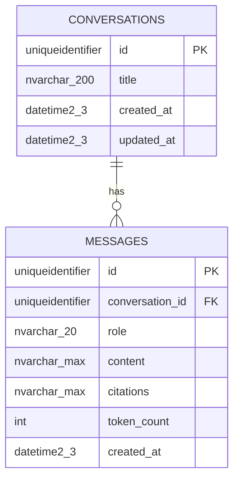

# Database design — project database

_The project's **own** Azure SQL Database (created by the use-case Bicep deployment before any model work — root
`CLAUDE.md` → "What you cannot do"; there is no local database). External databases go in
[`external-systems.md`](external-systems.md), not here._

## Overview

- **Azure resource:** logical server `sql-team-assistant-<env>` · database `team-assistant` · environments:
  dev / staging / prod (`infra/modules/sql-database.bicep` via `infra/main.bicep`)
- **Access from `apps/api`:** read/write via `DATABASE_URL` (Key Vault secret `DATABASE-URL`;
  managed identity when deployed)
- **Service tier / SKU:** dev `GP_S_Gen5` (serverless), staging `S0`, prod `S1` (`main.<env>.bicepparam`) — `ONLINE` index builds are not available on these tiers; both current tables are new, so nothing needs one
- **Conventions:** UUID primary keys (`UNIQUEIDENTIFIER`), `created_at`/`updated_at` with server
  defaults, snake_case table/column names, a length on every string column, constraints named by
  the template's naming convention (`app/db/base.py`)

## Entity diagram

Conversations are **shared**: there is no owner column until auth lands ([ADR-0014](../adr/0014-shared-conversations-until-auth.md)).
Models: `apps/api/app/models/conversation.py` · migration: revision `0001`.

## Tables

### `conversations`

| Column       | Type               | Null | Default                          | Notes                                                                             |
| ------------ | ------------------ | ---- | -------------------------------- | --------------------------------------------------------------------------------- |
| `id`         | `uniqueidentifier` | no   | `NEWID()` (and uuid4 in the ORM) | PK `pk_conversations`                                                             |
| `title`      | `nvarchar(200)`    | no   | `'New conversation'`             | the api replaces the default with the first question cut to 200 characters        |
| `created_at` | `datetime2(3)`     | no   | `SYSUTCDATETIME()`               | UTC                                                                               |
| `updated_at` | `datetime2(3)`     | no   | `SYSUTCDATETIME()`               | UTC; orders the conversation list, so the api sets it whenever a message is added |

- **Indexes:** none beyond the primary key (the list is small; add one on `updated_at` if it grows).
- **Foreign keys:** none.
- **PII / retention:** users' questions and the assistant's answers live in `messages`; this table holds only the title, which is the first question cut to 200 characters — treat it as user content. Kept indefinitely; no purge job in this release.
- **Expected volume:** low (an internal team); no concurrency-sensitive DDL needed yet.

### `messages`

| Column            | Type               | Null | Default                          | Notes                                                                                                               |
| ----------------- | ------------------ | ---- | -------------------------------- | ------------------------------------------------------------------------------------------------------------------- |
| `id`              | `uniqueidentifier` | no   | `NEWID()` (and uuid4 in the ORM) | PK `pk_messages`                                                                                                    |
| `conversation_id` | `uniqueidentifier` | no   |                                  | FK → `conversations.id`, `NO ACTION`                                                                                |
| `role`            | `nvarchar(20)`     | no   |                                  | `CHECK (role IN ('user','assistant'))` — `ck_messages_role_valid`                                                   |
| `content`         | `nvarchar(max)`    | no   |                                  | the question or the answer; **exception to the length rule**, see below                                             |
| `citations`       | `nvarchar(max)`    | yes  |                                  | JSON array of `{title, path}`; `CHECK (citations IS NULL OR ISJSON(citations)=1)` — `ck_messages_citations_is_json` |
| `token_count`     | `int`              | yes  |                                  | model-reported usage for assistant messages (which count: open question Q6 in `roadmaps/api/ROADMAP.md`)            |
| `created_at`      | `datetime2(3)`     | no   | `SYSUTCDATETIME()`               | UTC; messages are read oldest first                                                                                 |

- **Indexes:** `ix_messages_conversation_id` on `conversation_id`.
- **Foreign keys:** `fk_messages_conversation_id_conversations` → `conversations.id`, `ON DELETE NO ACTION` (deleting a conversation is out of scope; it would have to delete its messages first).
- **PII / retention:** full question and answer text, readable by every user, kept indefinitely (ADR-0014). Users must not enter personal or confidential data.
- **Expected volume:** low; rows are append-only.
- **Length exception:** `content` and `citations` are `nvarchar(max)` on purpose — an answer has no useful upper bound. This is the one place the "a length on every string column" convention does not apply. Text columns are `NVARCHAR` so non-ASCII questions and answers survive.

## Migration notes

- Revision `0001` creates both tables, the index and the constraints. It is hand-written and checked offline (`alembic upgrade head --sql`); a test (`tests/test_alembic.py`) proves it matches the models. It has **not** been applied to any database.
- Applying it is a human step: `migrate.yml` on `dev` after the offline SQL is reviewed (needs the `DEV_SQL_SERVER_FQDN` / `DEV_SQL_DATABASE` secrets and the contained SQL user).
- `ISJSON` needs database compatibility level 130 or higher (Azure SQL's default is higher).
- Nothing outside Alembic is needed: no extensions, roles or seed data.
